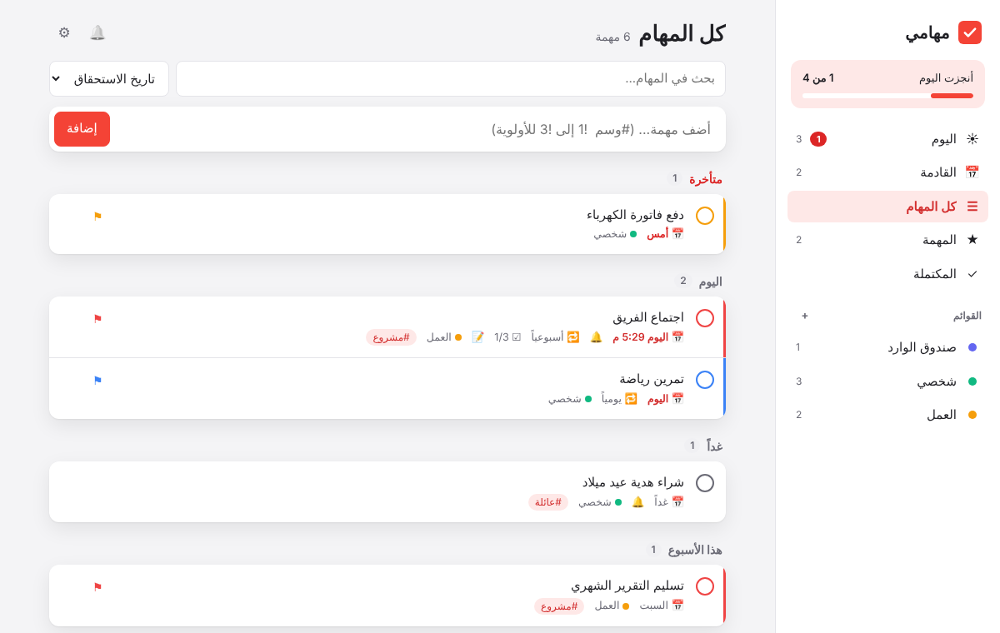
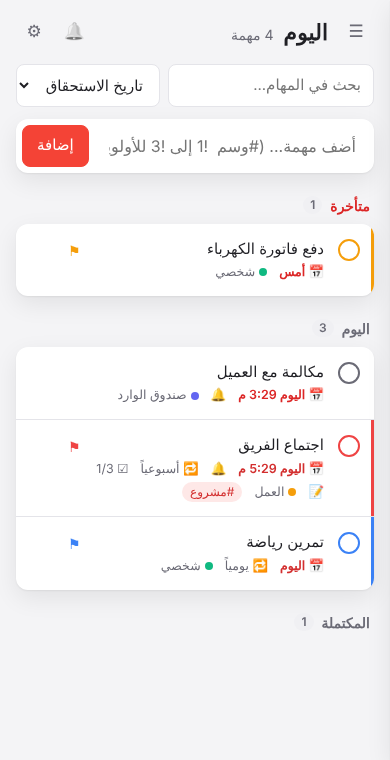
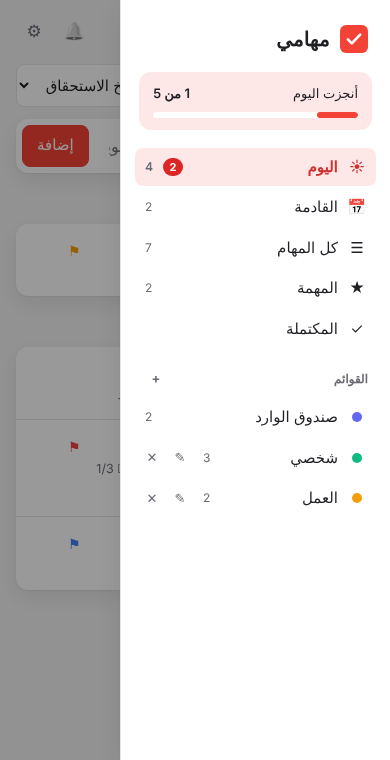
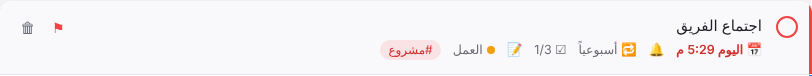
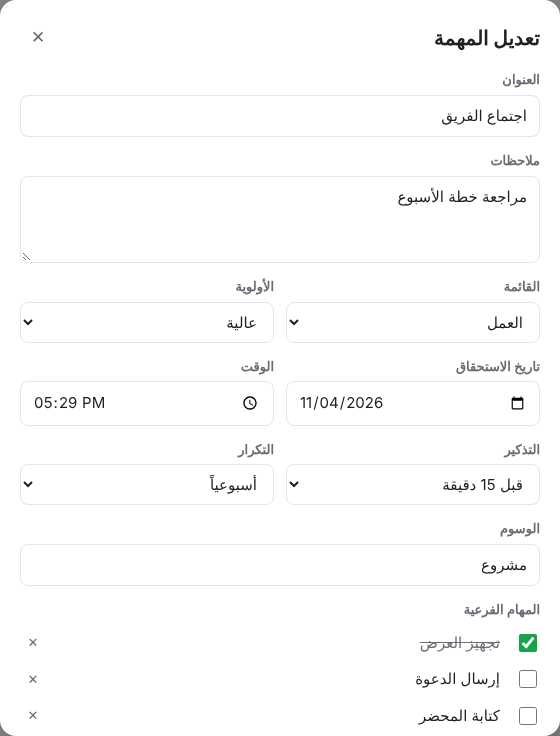

<div dir="rtl">

# دليل استخدام «مهامي» — نظام إدارة المهام والتذكيرات

الدليل ده بيشرح إزاي تنزّل التطبيق وتشغّله، وإزاي تستخدم كل مميزاته خطوة بخطوة.

## المحتويات

1. [نبذة عن التطبيق](#1-نبذة-عن-التطبيق)
2. [المتطلبات](#2-المتطلبات)
3. [التنزيل](#3-التنزيل)
4. [طرق التشغيل](#4-طرق-التشغيل)
5. [تثبيته كتطبيق على الموبايل أو الكمبيوتر](#5-تثبيته-كتطبيق-على-الموبايل-أو-الكمبيوتر)
6. [جولة في الواجهة](#6-جولة-في-الواجهة)
7. [إدارة المهام](#7-إدارة-المهام)
8. [القوائم](#8-القوائم)
9. [التذكيرات](#9-التذكيرات)
10. [المهام المتكررة](#10-المهام-المتكررة)
11. [البحث والترتيب](#11-البحث-والترتيب)
12. [الإعدادات](#12-الإعدادات)
13. [النسخ الاحتياطي ونقل البيانات](#13-النسخ-الاحتياطي-ونقل-البيانات)
14. [اختصارات لوحة المفاتيح](#14-اختصارات-لوحة-المفاتيح)
15. [حل المشاكل الشائعة](#15-حل-المشاكل-الشائعة)
16. [للمطورين: بنية المشروع](#16-للمطورين-بنية-المشروع)

---

## 1. نبذة عن التطبيق

«مهامي» تطبيق ويب لإدارة المهام، مكتوب بـ HTML و CSS و JavaScript عادي، من غير أي مكتبات ولا خطوة بناء (build). يعني مش محتاج تنزّل أي حاجة غير ملفات المشروع نفسها.

أهم مميزاته:

- صفحات جاهزة: **اليوم**، **القادمة**، **كل المهام**، **المهمة**، **المكتملة**.
- قوائم بألوان مختلفة تعملها بنفسك.
- لكل مهمة: ملاحظات، أولوية، تاريخ ووقت، وسوم، ومهام فرعية.
- تذكيرات بإشعار وصوت، مع تأجيل 10 دقايق.
- مهام بتتكرر يومياً أو أسبوعياً أو شهرياً وغيره.
- تصدير أي مهمة للتقويم بتاع موبايلك.
- عربي أو إنجليزي، ومظهر فاتح أو داكن.
- يشتغل من غير إنترنت، وممكن يتثبّت كتطبيق.

> **مهم:** كل البيانات بتتحفظ في المتصفح على جهازك بس (`localStorage`). مفيش سيرفر ولا حساب، ومفيش مزامنة بين الأجهزة. شوف [النسخ الاحتياطي](#13-النسخ-الاحتياطي-ونقل-البيانات) لو عايز تنقل مهامك من جهاز لجهاز.

---

## 2. المتطلبات

- **متصفح حديث:** Chrome أو Edge أو Firefox أو Safari (أي إصدار من آخر سنتين تلاتة).
- **اختياري:** [Node.js](https://nodejs.org) لو هتشغّله على سيرفر محلي (الطريقة المنصوح بيها، شوف تحت).
- **اختياري:** Git لو هتنزّل المشروع بيه.

---

## 3. التنزيل

### الطريقة الأولى: باستخدام Git

```sh
git clone https://github.com/Soliiiman/ToDo-List.git
cd ToDo-List
```

### الطريقة التانية: ملف ZIP

1. افتح صفحة المستودع على GitHub: <https://github.com/Soliiiman/ToDo-List>
2. اضغط زرار **Code** الأخضر، وبعدين **Download ZIP**.
3. فك ضغط الملف في أي فولدر.

---

## 4. طرق التشغيل

### أ) فتح الملف مباشرة (أسهل طريقة)

دبل كليك على ملف `index.html`، وهيفتح في المتصفح على طول.

التطبيق كله هيشتغل، بس فيه حاجتين مش هيشتغلوا بالطريقة دي:
- الشغل من غير إنترنت والتثبيت كتطبيق.
- إشعارات المتصفح ممكن متشتغلش في بعض المتصفحات.

عشان كده الطريقة (ب) أحسن.

### ب) سيرفر محلي (المنصوح بيها)

لو عندك Node.js، افتح الـ Terminal جوه فولدر المشروع واكتب:

```sh
npx http-server . -p 8080
```

وبعدين افتح المتصفح على: <http://localhost:8080>

<details>
<summary>بدائل لو مش عندك Node.js</summary>

- **Python:**
  ```sh
  python -m http.server 8080
  ```
- **VS Code:** نزّل إضافة **Live Server**، وبعدين كليك يمين على `index.html` ← **Open with Live Server**.

</details>

### ج) نشره على الإنترنت ببلاش (GitHub Pages)

دي أحسن طريقة لو عايز تستخدمه من الموبايل وتثبّته كتطبيق، لأن التثبيت محتاج رابط `https`.

1. افتح المستودع على GitHub ← **Settings** ← **Pages**.
2. تحت **Build and deployment**، خلّي **Source** على **Deploy from a branch**.
3. اختار الفرع `master` والفولدر `/ (root)`، واضغط **Save**.
4. استنى دقيقة أو اتنين، وهيظهر الرابط فوق. هيبقى غالباً:
   `https://soliiiman.github.io/ToDo-List/`

أي تحديث تعمله على `master` هيوصل للرابط ده تلقائياً.

---

## 5. تثبيته كتطبيق على الموبايل أو الكمبيوتر

بعد ما تفتحه من رابط `https` (زي GitHub Pages) أو من `localhost`:

| الجهاز | الخطوات |
|---|---|
| **أندرويد (Chrome)** | قائمة ⋮ ← **إضافة إلى الشاشة الرئيسية** أو **تثبيت التطبيق** |
| **آيفون (Safari)** | زرار المشاركة ⬆ ← **إضافة إلى الشاشة الرئيسية** |
| **كمبيوتر (Chrome / Edge)** | أيقونة التثبيت ⊕ في آخر شريط العنوان، أو القائمة ← **تثبيت مهامي** |

بعد التثبيت هيفتح في شباك لوحده زي أي تطبيق، وهيشتغل من غير نت.

> على الآيفون، إشعارات الويب مش بتشتغل غير لو التطبيق متثبّت على الشاشة الرئيسية (iOS 16.4 وأحدث).

---

## 6. جولة في الواجهة



### الشريط الجانبي

- **أنجزت اليوم:** بيوضح عملت كام مهمة من مهام النهارده.
- **الصفحات الجاهزة:**
  - **اليوم:** المهام اللي ميعادها النهارده، والمتأخرة كمان. لو فيه متأخرة هتلاقي رقمها بالأحمر.
  - **القادمة:** المهام اللي ميعادها من بكرة ورايح.
  - **كل المهام:** كل اللي لسه ماخلصش.
  - **المهمة:** المهام اللي أولويتها عالية.
  - **المكتملة:** كل اللي خلص، والأحدث فوق.
- **القوائم:** قوائمك، وجنب كل واحدة عدد المهام اللي لسه ماخلصتش فيها.

> **على الموبايل:** الشريط الجانبي بيبقى مستخبي، وبتفتحه من زرار ☰ فوق.

<p>
  
  &nbsp;
  
</p>

### المنطقة الرئيسية

- **العنوان:** اسم الصفحة اللي انت فيها، وعدد المهام.
- 🔔 **الإشعارات:** بيبقى رمادي لو الإشعارات مش متفعّلة، دوس عليه عشان تفعّلها.
- ⚙ **الإعدادات.**
- **البحث والترتيب.**
- **حقل الإضافة السريعة.**
- **المهام:** بتتقسّم لمجموعات حسب ميعادها: متأخرة، اليوم، غداً، هذا الأسبوع، لاحقاً، بدون تاريخ.

### شكل المهمة



| الرمز | معناه |
|---|---|
| ○ | دوس عليه عشان تعلّم المهمة إنها خلصت |
| خط ملوّن على جنب المهمة + ⚑ | الأولوية: أزرق منخفضة، برتقالي متوسطة، أحمر عالية |
| 📅 | الميعاد: بيبقى أحمر لو متأخرة، وملوّن لو النهارده |
| 🔔 | عليها تذكير |
| 🔁 | بتتكرر |
| ☑ 1/3 | خلصت كام مهمة فرعية من كام |
| 📝 | فيها ملاحظات |
| ● العمل | القائمة اللي هي فيها |
| #مشروع | وسم، دوس عليه عشان تشوف كل المهام اللي عليها نفس الوسم |
| 🗑 | حذف (بيظهر لما تقف بالماوس على المهمة) |

---

## 7. إدارة المهام

### إضافة سريعة

اكتب اسم المهمة في الحقل اللي فوق واضغط **Enter** أو **إضافة**.

وانت بتكتب، تقدر تضيف:
- **وسوم:** اكتب `#` وبعدها الكلمة، زي `#عمل`.
- **أولوية:** `!1` منخفضة، `!2` متوسطة، `!3` عالية.

مثال:

```
اتصل بأحمد #عمل #عاجل !3
```

ده هيعمل مهمة اسمها «اتصل بأحمد»، عليها وسمين «عمل» و«عاجل»، وأولويتها عالية.

المهمة الجديدة بتاخد حاجات تلقائياً حسب الصفحة اللي انت فيها:

| انت في صفحة | المهمة الجديدة |
|---|---|
| اليوم | ميعادها النهارده |
| القادمة | ميعادها بكرة |
| المهمة | أولويتها عالية |
| قائمة معينة | بتتضاف للقائمة دي |
| كل المهام | بتتضاف لصندوق الوارد من غير تاريخ |

### تعديل مهمة وإضافة تفاصيل

دوس على اسم المهمة، وهيفتح شباك التعديل وفيه:



| الحقل | استخدامه |
|---|---|
| **العنوان** | اسم المهمة (لازم تكتبه) |
| **ملاحظات** | أي تفاصيل زيادة |
| **القائمة** | تنقل المهمة لقائمة تانية |
| **الأولوية** | بدون، منخفضة، متوسطة، عالية |
| **تاريخ الاستحقاق** و**الوقت** | ميعاد المهمة. الوقت اختياري |
| **التذكير** | شوف [التذكيرات](#9-التذكيرات) |
| **التكرار** | شوف [المهام المتكررة](#10-المهام-المتكررة) |
| **الوسوم** | افصل بينها بفاصلة (`,` أو `،`) |
| **المهام الفرعية** | اكتب الخطوة واضغط Enter عشان تضيفها، وتقدر تعلّم عليها أو تعدّلها أو تحذفها بـ ✕ |

وتحت فيه زراير: **حفظ**، **إلغاء**، **حذف**، و**إضافة للتقويم**. زرار التقويم بيظهر بس لو المهمة ليها تاريخ.

### إكمال مهمة

دوس على الدايرة ○ اللي جنب المهمة. هيظهر لك إشعار صغير فيه زرار **تراجع** لو دوست بالغلط.

المهام اللي خلصت بتظهر في صفحة **المكتملة**. وكمان في صفحة **اليوم** وصفحات القوائم، هتلاقي تحت قسم صغير اسمه «المكتملة» تقدر تفتحه وتقفله.

ولو عايز ترجّع مهمة خلصت، دوس على الدايرة بتاعتها تاني.

### حذف مهمة

- دوس على 🗑 جنب المهمة، أو افتحها ودوس **حذف**.
- هيظهر إشعار فيه زرار **تراجع** لمدة كام ثانية، لو رجعت في كلامك.

ولو عايز تحذف كل المهام المكتملة مرة واحدة: ⚙ الإعدادات ← **حذف المكتملة**.

---

## 8. القوائم

- **قائمة جديدة:** دوس على **+** جنب كلمة «القوائم» واكتب الاسم. هتاخد لون تلقائي.
- **تغيير الاسم:** اقف بالماوس على القائمة ودوس ✎. على الموبايل الزرار ظاهر على طول.
- **حذف قائمة:** دوس ✕. المهام اللي فيها مش هتتمسح، هتتنقل لـ«صندوق الوارد».
- **صندوق الوارد** مينفعش يتحذف.

> القوائم الأساسية (صندوق الوارد، شخصي، العمل) بتتغير لغتها مع لغة التطبيق، إلا لو غيّرت اسمها بنفسك.

---

## 9. التذكيرات

### تفعيل الإشعارات (مرة واحدة)

1. دوس على 🔔 فوق، أو ادخل ⚙ الإعدادات ← **تفعيل الإشعارات**.
2. المتصفح هيسألك، اختار **سماح / Allow**.

ولو ضفت تذكير قبل ما تفعّل الإشعارات، التطبيق هيفكّرك تفعّلها.

### إضافة تذكير لمهمة

1. افتح المهمة.
2. حدد **تاريخ الاستحقاق**، والوقت لو حابب.
3. اختار التذكير: **في الموعد**، أو **قبل 5 / 15 / 30 دقيقة**، أو **قبل ساعة**، أو **قبل يوم**.
4. اضغط **حفظ**.

> لو المهمة ليها تاريخ من غير وقت، التذكير بيتحسب على إن الميعاد الساعة **9 الصبح**.
>
> ولو اخترت تذكير من غير ما تحط تاريخ، هتظهر رسالة «التذكير يحتاج إلى تاريخ استحقاق».

### لما ييجي ميعاد التذكير


هيحصل 3 حاجات:
1. **إشعار من الجهاز** (لو الإشعارات متفعّلة). لو دوست عليه، المهمة هتفتح.
2. **صوت تنبيه** (تقدر تقفله من الإعدادات).
3. **تنبيه جوه التطبيق** فيه 3 زراير:
   - **تمت:** تعلّم المهمة إنها خلصت.
   - **تأجيل 10 دقائق:** يفكّرك تاني بعد 10 دقايق.
   - **تجاهل:** يقفل التنبيه.

### ⚠️ مهم: التطبيق لازم يكون مفتوح

إشعارات المتصفح مش بتشتغل غير والتطبيق مفتوح. حتى لو في تبويب مستخبي أو الشباك متصغّر، هتوصلك عادي.

لو فتحت التطبيق بعد ميعاد التذكير (بس في خلال 24 ساعة)، هيظهر لك التذكير اللي فاتك.

### التذكير والتطبيق مقفول: «إضافة للتقويم»

عشان التقويم بتاع موبايلك أو جهازك هو اللي يفكّرك حتى لو التطبيق مقفول:

1. افتح المهمة (لازم يكون ليها تاريخ).
2. دوس **إضافة للتقويم**، وهينزل ملف بامتداد `.ics`.
3. افتح الملف، وهيتضاف في تقويم Google أو تقويم الآيفون أو Outlook، ومعاه التذكير والتكرار.

> لو غيّرت ميعاد المهمة بعد كده، صدّرها تاني. الملف اللي في التقويم مش بيتحدّث لوحده.

---

## 10. المهام المتكررة

من شباك التعديل اختار **التكرار**:

| الاختيار | الموعد اللي بعده |
|---|---|
| يومياً | اليوم اللي بعده |
| أيام العمل (الأحد - الخميس) | يوم العمل اللي بعده (بيتخطّى الجمعة والسبت) |
| أسبوعياً | بعد 7 أيام |
| شهرياً | نفس اليوم في الشهر اللي بعده |
| سنوياً | نفس اليوم في السنة اللي بعدها |

**لما تخلّص مهمة بتتكرر:**
- المهمة نفسها بتتنقل لموعدها الجاي، والمهام الفرعية بترجع كلها مش متعلّم عليها.
- نسخة منها بتتسجل في **المكتملة**، عشان تفضل فاكر إنك عملتها.
- هيظهر إشعار صغير فيه الموعد الجاي.

> لو المهمة كانت متأخرة كتير، الموعد الجاي عمره ما هيبقى في الماضي.
>
> لو مهمة شهرية ميعادها يوم 31 جه عليها شهر أقصر، ميعادها بيتنقل لآخر يوم في الشهر ده (28 أو 30)، وبيكمّل على اليوم ده بعد كده.

---

## 11. البحث والترتيب

### البحث

- اكتب في خانة البحث، وهيدوّر في كل المهام: العناوين والملاحظات والوسوم والمهام الفرعية، سواء المكتملة أو لأ.
- لو كتبت `#وسم` (زي `#عمل`)، هيجيب بس المهام اللي عليها الوسم ده بالظبط.
- لو دوست على أي وسم في مهمة، هيبحث بيه على طول.
- امسح خانة البحث عشان ترجع للصفحة اللي كنت فيها.

### الترتيب

من القائمة اللي جنب البحث:

| الترتيب | النتيجة |
|---|---|
| **تاريخ الاستحقاق** (الأساسي) | الأقرب ميعاداً فوق، ومقسّمة: متأخرة، اليوم، غداً، هذا الأسبوع، لاحقاً، بدون تاريخ |
| **الأولوية** | العالية فوق |
| **تاريخ الإضافة** | الأحدث فوق |
| **الاسم** | أبجدياً |

---

## 12. الإعدادات

افتحها من ⚙:

| الإعداد | الوصف |
|---|---|
| **الإشعارات** | بيوضح الإشعارات متفعّلة ولا لأ، وفيه زرار تفعّلها منه |
| **صوت التنبيه** | تشغّل أو تقفل صوت التذكير |
| **اللغة** | العربية (من اليمين لليسار) أو English |
| **المظهر** | تلقائي (زي إعداد جهازك)، فاتح، أو داكن |
| **البيانات** | تصدير، استيراد، وحذف المكتملة |

التطبيق بيفتكر كل الإعدادات دي.

---

## 13. النسخ الاحتياطي ونقل البيانات

بياناتك محفوظة في المتصفح بس، فخد بالك:
- لو مسحت بيانات المتصفح أو الكوكيز، المهام هتتمسح.
- كل متصفح ليه بياناته لوحده، يعني مهامك على Chrome مش هتلاقيها على Firefox.
- وكل رابط ليه بياناته لوحده، يعني `localhost` غير GitHub Pages.

### عمل نسخة احتياطية

⚙ الإعدادات ← **تصدير نسخة احتياطية**، وهينزل ملف اسمه زي `tasks-backup-2026-11-04.json`.

### الاسترجاع أو النقل لجهاز تاني

1. انقل ملف النسخة للجهاز التاني.
2. افتح التطبيق هناك ← ⚙ ← **استيراد نسخة احتياطية** ← اختار الملف.

> الاستيراد **بيضيف** المهام على اللي موجود، مش بيمسح القديم. لو المهمة كانت موجودة بنفس الـ ID، بتتضاف كنسخة جديدة.

### لو كنت بتستخدم النسخة القديمة

لو كان عندك مهام محفوظة في النسخة القديمة من التطبيق، هتتنقل تلقائياً أول مرة تفتح النسخة الجديدة.

---

## 14. اختصارات لوحة المفاتيح

| المفتاح | الوظيفة |
|---|---|
| `N` | تروح لحقل إضافة مهمة |
| `/` | تروح لخانة البحث |
| `Enter` | تضيف المهمة، أو تضيف مهمة فرعية في شباك التعديل |
| `Esc` | تقفل الشباك المفتوح |
| `Tab` / `Space` | تتنقل بين العناصر وتدوس عليها |

---

## 15. حل المشاكل الشائعة

<details>
<summary><b>الإشعارات مش بتظهر</b></summary>

1. اتأكد إن 🔔 مش رمادي، وإن الإعدادات مكتوب فيها «الإشعارات مفعّلة».
2. لو مكتوب «محظورة»: دوس على أيقونة القفل 🔒 جنب الرابط في المتصفح ← **الإشعارات** ← **سماح**، وبعدين اعمل ريفرش للصفحة.
3. اتأكد إن إشعارات المتصفح نفسه مسموحة من إعدادات الجهاز، ووضع «عدم الإزعاج» مقفول.
4. شغّل التطبيق من سيرفر أو من GitHub Pages، مش من الملف مباشرة.
5. على الآيفون: لازم تثبّت التطبيق على الشاشة الرئيسية الأول.
6. وافتكر إن التطبيق لازم يكون مفتوح. للتذكير والتطبيق مقفول استخدم **إضافة للتقويم**.

</details>

<details>
<summary><b>الصوت مش شغّال</b></summary>

المتصفحات مش بتسمح بالصوت غير بعد ما تتفاعل مع الصفحة. دوس أي حتة في التطبيق مرة بعد ما تفتحه. واتأكد إن **صوت التنبيه** شغّال في الإعدادات.

</details>

<details>
<summary><b>المهام اختفت</b></summary>

- اتأكد إنك فاتح نفس المتصفح ونفس الرابط اللي كنت شغال عليه.
- اتأكد إن خانة البحث فاضية، وإنك في الصفحة الصح (جرّب «كل المهام» أو «المكتملة»).
- لو مسحت بيانات المتصفح، رجّع آخر نسخة احتياطية عندك.

</details>

<details>
<summary><b>عدّلت في الكود ومش شايف التعديل</b></summary>

التطبيق بيجيب أحدث نسخة من السيرفر الأول، وبيستخدم النسخة المحفوظة بس لو مفيش نت. لو التعديل لسه مش ظاهر، اعمل ريفرش كامل بـ `Ctrl + Shift + R`، أو من أدوات المطوّر: **Application** ← **Service Workers** ← **Unregister**.

</details>

<details>
<summary><b>زرار «تثبيت التطبيق» مش ظاهر</b></summary>

التثبيت محتاج رابط `https` أو `localhost`، ومش بيشتغل من ملف مفتوح مباشرة. استخدم GitHub Pages أو سيرفر محلي.

</details>

---

## 16. للمطورين: بنية المشروع

| الملف | وظيفته |
|---|---|
| `index.html` | شكل الصفحة: الشريط الجانبي، المهام، شباك التعديل، الإعدادات |
| `css/styles.css` | التنسيق: ألوان، فاتح وداكن، من اليمين لليسار، الموبايل |
| `js/i18n.js` | كل النصوص بالعربي والإنجليزي |
| `js/store.js` | البيانات والحفظ والتواريخ والتكرار |
| `js/reminders.js` | التذكيرات والإشعارات والصوت وتصدير `.ics` |
| `js/app.js` | الواجهة: عرض المهام وكل الأحداث |
| `sw.js` | Service Worker: شغل من غير نت والضغط على الإشعارات |
| `manifest.webmanifest` | بيانات تثبيت التطبيق |
| `icon.svg` | الأيقونة |
| `docs/` | الدليل ده وصوره |

السكربتات بتتحمّل بالترتيب ده: `i18n` ← `store` ← `reminders` ← `app`. كلها بتشارك كائن واحد اسمه `window.App`.

### شكل المهمة في البيانات

```js
{
  id: "lq3k9x2abc",          // معرّف فريد
  title: "اجتماع الفريق",
  notes: "",
  list: "inbox",             // ID القائمة
  priority: 0,               // 0 بدون، 1 منخفضة، 2 متوسطة، 3 عالية
  due: "2026-11-04",         // YYYY-MM-DD أو ""
  time: "15:00",             // HH:MM أو ""
  remind: 15,                // كام دقيقة قبل الميعاد، و-1 يعني من غير تذكير
  repeat: "weekly",          // none | daily | weekdays | weekly | monthly | yearly
  tags: ["مشروع"],
  subtasks: [{ id, text, done }],
  done: false,
  createdAt: 1730700000000,
  completedAt: null,
  remindedAt: null,          // ميعاد آخر تذكير ظهر، عشان ميتكررش
  snoozeUntil: null          // لو التذكير متأجل، لحد إمتى
}
```

البيانات كلها محفوظة تحت المفتاح `taskmanager.v2` في `localStorage`.

### إضافة لغة جديدة

1. في `js/i18n.js` ضيف كائن جديد جوه `STRINGS` (مثلاً `fr`) فيه نفس المفاتيح.
2. في `index.html` ضيف زرار جوه `#langSeg` عليه `data-value="fr"`.
3. لو اللغة بتتكتب من اليمين لليسار، عدّل شرط `dir` في `setLang`.

### تعديل وقت التذكير الافتراضي أو مدة التأجيل

- `DEFAULT_REMINDER_TIME` في `js/store.js` (الافتراضي `"09:00"`).
- `SNOOZE_MS` في `js/reminders.js` (الافتراضي 10 دقايق).

### بعد ما تعدّل في الملفات

لو ضفت ملف جديد أو غيّرت اسم ملف، ضيفه في `ASSETS` في `sw.js`، وغيّر `CACHE` لرقم جديد (مثلاً `taskmanager-v2`) عشان النسخة القديمة تتمسح من الكاش.

</div>
